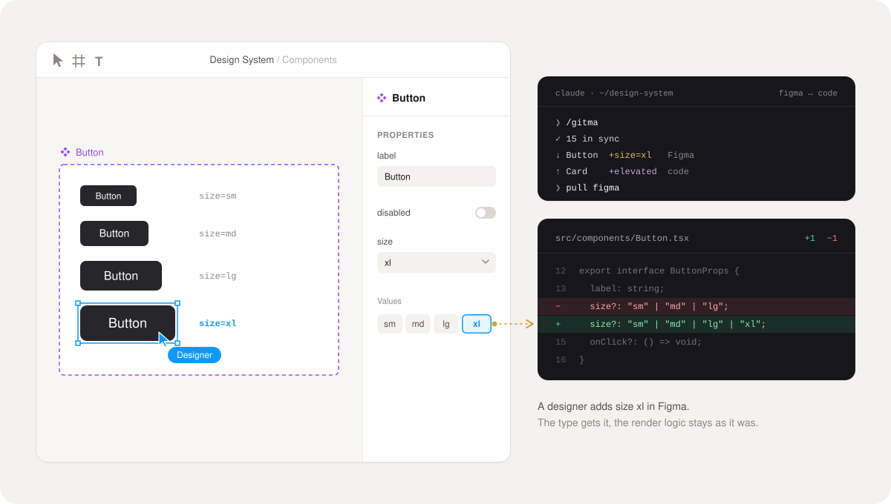
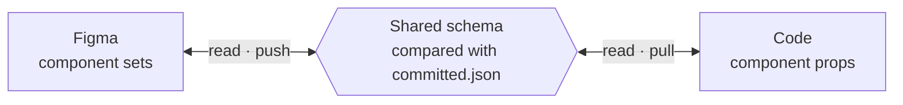

<div align="center">

# Gitma

**Your Figma components and your code, compared and kept in step.**

A command for Claude Code that reads both sides, names every difference,
and applies the change you approve, in either direction.

</div>

<br>

> **Runs inside Claude Code**, with your file open in Figma Desktop. It reads
> Figma components that have variants, and the typed props of your code
> components. [See what you need](#what-you-need).

<br>



<br>

## Why

A design system lives in two places. A designer adds a variant in Figma, a
developer adds a prop in code, and the two drift apart quietly until a handoff
goes wrong and nobody is sure which side is current.

Gitma compares both sides against the last version they agreed on and tells you
what changed where: Button gained `size=xl` in Figma, Card gained `elevated` in
code. You decide what moves. Nothing is written to Figma or to your files until
you've seen the change and said yes.

It syncs the contract between design and code (props, variants, slots, states
and token references) and leaves alone what belongs to each side: how a
component looks stays in Figma, how it works stays in your code.

## What you need

- **[Claude Code](https://claude.com/claude-code)** with the [figma-console MCP server](https://www.npmjs.com/package/figma-console-mcp).
- **[Figma Desktop](https://www.figma.com/downloads/)** with its bridge plugin. The plugin doesn't run in Figma in the browser.
- **Components with variants in Figma.** Gitma reads component sets; a single component without variants isn't picked up yet.
- **Components in code** in React, Vue, Svelte, Angular or SolidJS. Gitma looks at the ones you already have and writes the same way.

Nothing is added to your project's dependencies. Gitma is one command file, and
what it remembers lives in a `.gitma/` folder.

## Setup (once)

**1. Connect Claude Code to Figma** with the figma-console MCP server:

```bash
claude mcp add figma-console -s user -- npx -y figma-console-mcp@latest
```

**2. Install the bridge plugin in Figma Desktop.** Print where its manifest is:

```bash
npx figma-console-mcp --print-path
```

Then in Figma go to **Plugins → Development → Import plugin from manifest** and
pick that file (usually `~/.figma-console-mcp/plugin/manifest.json`).

**3. Add the `/gitma` command**, either to one project, committed so your team
gets it too:

```bash
mkdir -p .claude/commands
curl -o .claude/commands/gitma.md https://raw.githubusercontent.com/lucadebort/gitma/main/commands/gitma.md
```

or to every project on your machine:

```bash
mkdir -p ~/.claude/commands
curl -o ~/.claude/commands/gitma.md https://raw.githubusercontent.com/lucadebort/gitma/main/commands/gitma.md
```

## Use it

Open your file in Figma Desktop and run the bridge plugin
(**Plugins → Development → Figma Desktop Bridge**). Then, in Claude Code:

```
/gitma
```

The first time, Gitma asks for your Figma file URL and where your components
live, reads a few of them to learn your conventions, and saves what it found in
`.gitma/config.json`. From then on it reads both sides and reports:

```
Figma file: "Design System" (32 components)
Code: src/components/ (18 components)

✓ 15 in sync
↓ 2 with Figma drift:
  Button: +size=xl (Figma added variant value)
  Badge: +isLoading (Figma added boolean prop)
↑ 1 with code drift:
  Card: +elevated (code added boolean prop)

Want me to pull from Figma, push to Figma, or show details?
```

Answer in plain words. Before anything is written, Gitma shows exactly what will
change and asks you to confirm. Breaking changes, like a removed prop or a
changed type, are called out with what they'll affect. After a push it reads the
component back from Figma to check the change landed.

## Commands

| Command | What it does |
| --- | --- |
| `/gitma` | Read both sides, show the status, suggest what to do |
| `/gitma status` | Show the status only |
| `/gitma diff` | Show the full diff, in both directions |
| `/gitma pull figma` | Apply Figma's changes to your code |
| `/gitma push code` | Apply your code's changes to Figma |
| `/gitma generate Badge` | Write a new component from its Figma definition and tokens |
| `/gitma preview` | Build an interactive preview of the whole design system |
| `/gitma update` | Replace the command file with the latest version |

## What it does

### Pull, from Figma to code

Gitma edits only a component's contract: its props type and the parameters that
read them. It follows the file as it is (an interface or a type alias,
`defineProps` in Vue, PropTypes; the same quotes, semicolons and indentation)
and never touches the template, the JSX or the render logic.

### Push, from code to Figma

New boolean and text props become component properties, new slots become
instance swap properties, and removed props are deleted. A new variant value is
made by cloning the nearest existing variant and placing the copies below the
set, so the component set stays tidy.

### Generate from Figma

`/gitma generate Badge` reads the component's structure, its visual properties
and the variables bound to them, and writes a new component in your project's
stack and style. If your existing components disagree with each other, or there
are none yet, Gitma asks which way to go instead of guessing.

### Interactive preview

`/gitma preview` builds `.gitma/preview/index.html`, a self-contained page with
your whole design system:

- every component, rendered with CSS from your Figma tokens, with controls for its variants, booleans and text
- an inspect panel that traces each colour, spacing and radius back to its Figma variable
- the component's code, ready to copy
- a tokens page with every variable and colour scale, in light and dark mode

It reports progress while it works (`✅ Badge 1/12`, `⏳ Button 2/12`).

## What it can sync

| From Figma | To code |
| --- | --- |
| Variant property | Union type or enum prop |
| Variant values (`sm`, `md`, `lg`) | Type values |
| Boolean property | `boolean` prop or state |
| Text property | `string` prop |
| Instance swap | Slot or child component |

| From code | To Figma |
| --- | --- |
| New boolean prop | Boolean property |
| New string prop | Text property |
| New slot | Instance swap property |
| Removed prop | Property deleted |
| New variant value | Variant cloned, renamed and placed |

## How it works



### One schema for both sides

Gitma doesn't treat Figma or code as the one that's right. It turns both into
the same neutral format, a list of components with their props, variants,
slots, states and token references, and compares each of them against a
baseline: the last state both sides agreed on.

| Snapshot | What it is |
| --- | --- |
| `.gitma/snapshots/committed.json` | The baseline, the last agreed state |
| `.gitma/snapshots/figma.json` | Figma as it was at the last read |

Code is read live from your files every time, so it needs no snapshot.

The workflow borrows from git:

1. **status** reads both sides and compares them with the baseline
2. **diff** lists what was added, removed or modified, per component
3. **stage** picks the changes you accept
4. **commit** saves them as the new baseline
5. **pull** and **push** apply them to the other side

When both sides change the same thing, say the designer renames a variant and
the developer renames it differently, Gitma reports a **conflict**, shows both
versions and asks you to choose.

### What Figma owns and what code owns

Figma components are mostly visual: layout, colour, spacing, type, variant
options, slot structure. Code components carry behaviour: event handlers,
validation, async state, business rules. The schema keeps the two apart through
the prop types:

| Prop type | Synced to Figma? | Example |
| --- | --- | --- |
| `string` | Yes | `label`, `placeholder` |
| `number` | Yes | `maxLength`, `columns` |
| `boolean` | Yes | `disabled`, `loading` |
| `enum` | Yes | `size: "sm" \| "md" \| "lg"` |
| `node` | Yes, as an instance swap | `icon`, `children` |
| `callback` | No, code only | `onClick`, `onSubmit` |
| `object` | No, code only | `style`, `config` |

Add an `onClick` handler and Gitma records it in the schema but never pushes it
to Figma. Add a variant value in Figma and Gitma proposes it for your types, but
never writes behaviour for it.

**Figma decides how it looks, code decides how it works, and the schema keeps
track of both.**

## Limits worth knowing

- **Component sets only.** A Figma component without variants isn't read yet.
- **The contract, not the styling.** A pull updates props and types. Visual changes inside a component's markup still go through your editor.
- **Figma Desktop.** The bridge plugin doesn't run in the browser.
- **Interactive only.** There's no CI check yet; a future `gitma check` could fail a build when drift passes a threshold.

## FAQ

**What's the source of truth?**
Neither Figma nor code. It's `committed.json`, the last version both sides
agreed on. Think of it as `main`, with Figma and code as two branches compared
against it.

**I have Figma but no code yet.**
Gitma reads your file and the result becomes your first `committed.json`. From
there you can generate components (`/gitma generate Button`) or use the preview
to explore the system.

**I have code but no Figma yet.**
The same, the other way round: Gitma reads your components and you push them to
Figma when you're ready.

**Does Gitma write my components' behaviour?**
No. It syncs the interface (props, variants, slots, states, tokens). Event
handlers, validation, API calls and business logic stay yours, and the render
logic is never touched.

**What if the designer and the developer change the same thing?**
That's a conflict. If the designer changes `size` from `sm/md/lg` to
`xs/sm/md/lg/xl` while the developer changes it to `small/medium/large`, Gitma
shows both and asks you to pick one, or to merge them by hand.

**How are design tokens handled?**
In the [W3C Design Tokens format](https://www.designtokens.org/)
(`.tokens.json`), extracted from your Figma variables. Each component's schema
has `tokenRefs` that link a property (`background-color`) to a token path
(`color.primary.500`).

**My Figma names don't match my code names.**
Map them in `.gitma/config.json`: `componentNameMap` for components,
`propertyMap` for props and variants. See [Configuration](#configuration).

**How do I update Gitma?**
Run `/gitma update`. It downloads the latest command file from this repository.

## Configuration

On the first run, `/gitma` creates `.gitma/config.json` with your Figma file and
component paths, plus the stack and conventions it detected, so it doesn't
detect them every time:

```json
{
  "figmaFileKey": "your-figma-file-key",
  "componentGlobs": ["src/components/**/*.tsx"],
  "tokenFile": "tokens.tokens.json",
  "tokenFormat": "css-vars",
  "formatCommand": "npx prettier --write"
}
```

| Field | Required | |
| --- | --- | --- |
| `componentGlobs` | Yes | Glob patterns that find your component files |
| `figmaFileKey` | No | The Figma file key, taken from its URL |
| `tokenFile` | No | Path to your `.tokens.json` (W3C format) |
| `tokenFormat` | No | How code uses tokens: `css-vars` or `tailwind` |
| `formatCommand` | No | Run after every code change, e.g. Prettier |
| `componentNameMap` | No | Figma name → code name |
| `propertyMap` | No | Per-component prop and variant names |

### Name mapping

```json
{
  "componentNameMap": {
    "Button ": "Button",
    "Fab test": "FloatingActionButton"
  }
}
```

### Property mapping

```json
{
  "propertyMap": {
    "Button": {
      "props": { "buttonLabel": "children", "showLabel": null },
      "variantToState": {
        "state": { "isDisabled": "disabled", "isHovered": null }
      }
    }
  }
}
```

`props` renames Figma props to their code names. `variantToState` turns the
values of a Figma variant into boolean states in code: here the `state` variant's
`isDisabled` becomes `disabled`. `null` leaves a prop or a value out of the
comparison, and an `ignore` list skips Figma properties entirely.

## License

ISC
